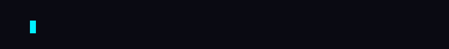
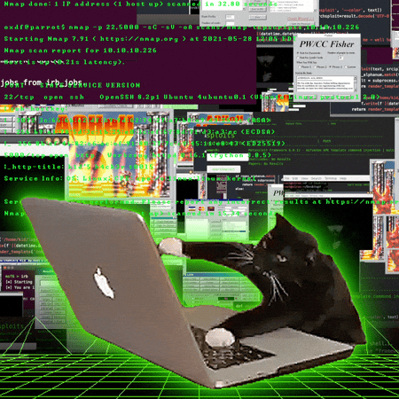
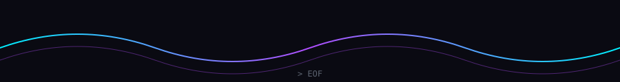

<div align="center">





</div>

---

### // ABOUT



I am a software engineering student focused on backend systems and software architecture. I like understanding how software works beneath the abstractions, and I build projects to test and deepen that understanding.

<br clear="right"/>

```yaml
name:      Quan (Lucas)
role:      Software Engineering Student
base:      Da Nang, Vietnam
system:    Fedora Linux · Niri
focus:     backend · full-stack · architecture
interests: cybersecurity · open source · machine learning
```

---

### // STACK

<div align="center">

**Languages**


**Frameworks & Runtime**


**Data & Tooling**


</div>

---

<!--
### // PROJECTS

| Project | What it does | Stack |
|---|---|---|
| [repo-name](https://github.com/ljq-exe/repo-name) | One line on the problem it solves | NestJS, PostgreSQL |

Uncomment this block once you have real repositories to feature.
-->

### // CONNECT

<div align="center">

<a href="https://linkedin.com/in/your-profile](https://www.linkedin.com/in/qu%C3%A2n-ph%E1%BA%A1m-41919641a">
  
</a>
<a href="https://github.com/ljq-exe">
  
</a>
<a href="mailto:your.email@example.com">
  
</a>

</div>

---

<div align="center">



</div>
